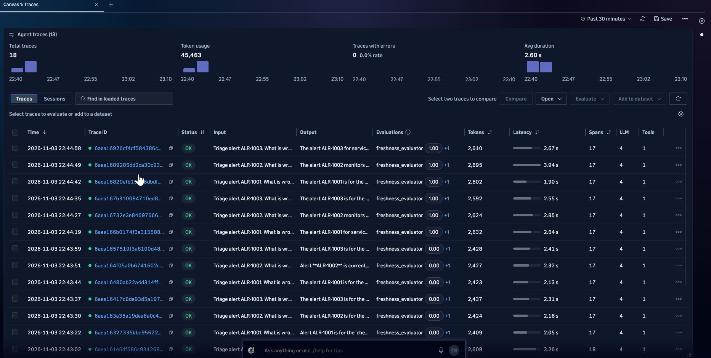
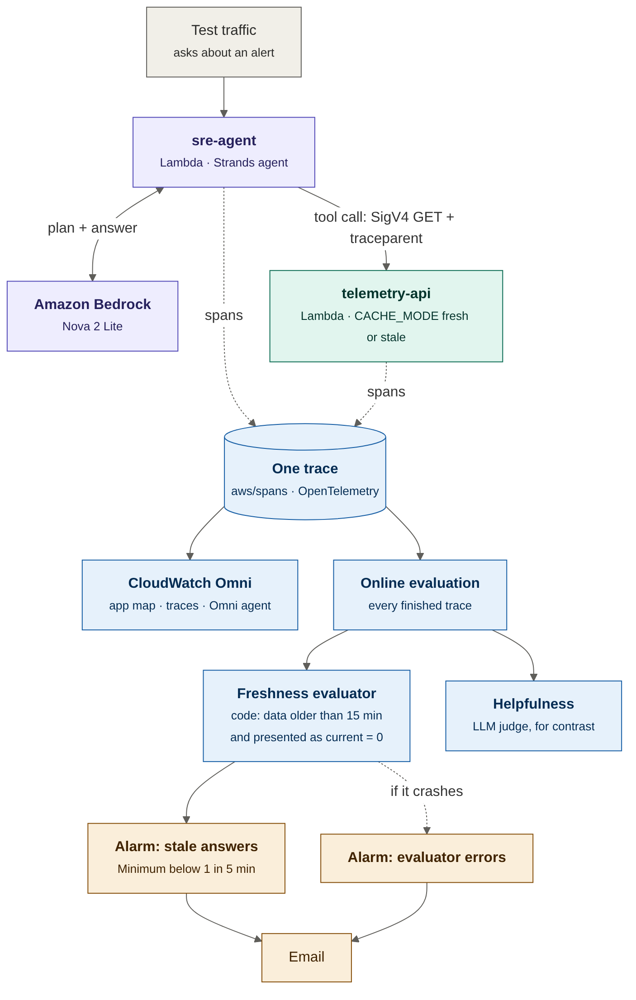
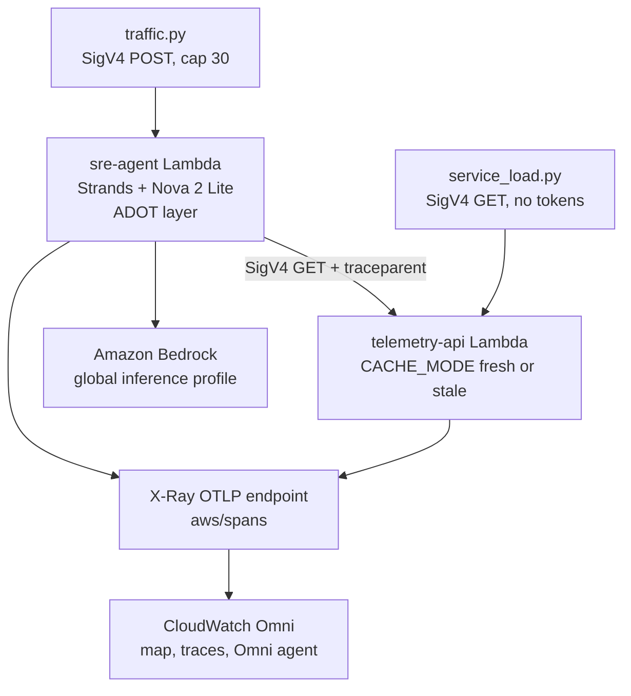
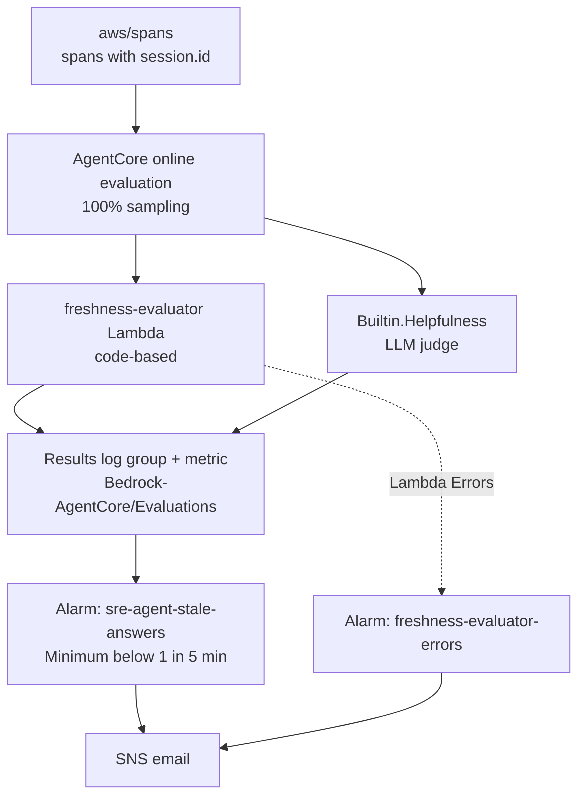
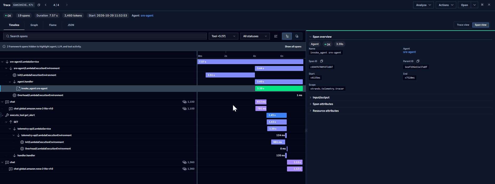
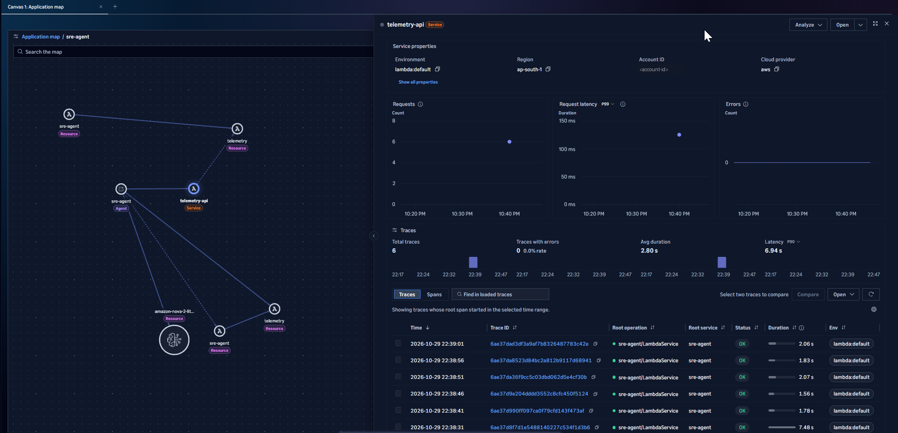
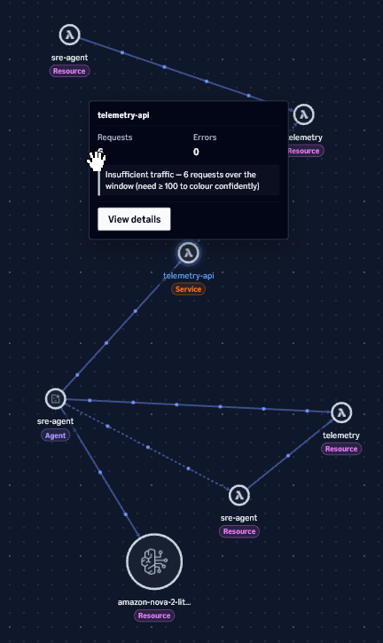
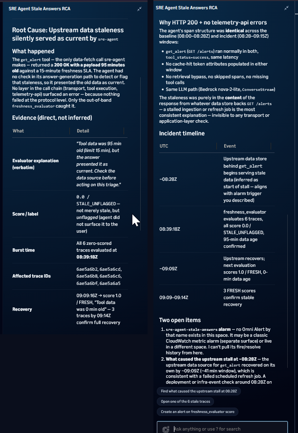
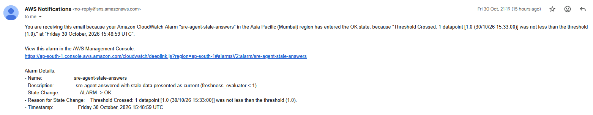

# Zero errors, wrong answers: catching stale data behind an AI agent with CloudWatch Omni

A reference build that shows a failure classic monitoring cannot see. An SRE triage agent calls a telemetry service. A bad deploy makes the service return old data with HTTP 200 and lower latency. Every dashboard stays green, and the agent tells the on-call engineer the incident is over:

> "The current value is 610 ms, which is below the threshold of 800 ms … The data is very fresh … The measurement was taken moments ago."

The data was 96 minutes old.

This repo builds the agent and the service on AWS Lambda, traces both into one trace with OpenTelemetry, scores every answer with a custom freshness evaluator in Amazon CloudWatch Omni, alarms on the score, compares the Omni agent's root cause analysis with CloudTrail ground truth, and proves a prompt fix with an A/B experiment on live traffic.



## In plain words

Think of a new on-call engineer who reads a monitoring dashboard to decide whether an incident is over. If the dashboard quietly shows numbers from an hour ago, the engineer will confidently say "all good" and close the incident. Nothing crashed. Nobody got an error. The answer was still wrong.

An AI agent has the same weakness. It trusts whatever its tools return. Classic monitoring checks whether services are up, fast and error free, so it stays green. What it does not check is whether the agent's answer was true.

This build adds that missing check:

1. **Trace the agent and the services it calls together**, so one trace shows the question, the model calls, the tool call and the service that answered it.
2. **Score every answer with a rule you can explain in one sentence**: "if the data is older than 15 minutes, the answer must say so." The rule runs as code, not as another model's opinion.
3. **Alarm on the score**, and alarm on the scorer itself, because a broken checker is silent.
4. **Fix the agent and measure the fix** on the same live traffic before and after.

### Where this pattern applies

Any agent that answers from data it fetches at run time can be confidently wrong when that data is stale, cached or partial:

| Industry | Agent | Stale data risk |
|---|---|---|
| IT operations | On-call copilot reading alerts and metrics | Closes a live incident based on an old snapshot |
| E-commerce and logistics | Support agent reading order and shipment status | Tells a customer an order shipped when it did not |
| Financial services | Assistant reading balances, prices or limits | Quotes a cached price or an old balance as current |
| Travel and hospitality | Booking agent reading seat or room availability | Confirms availability that is gone |
| Healthcare operations | Scheduling agent reading appointment slots | Offers a slot that was already taken |

The same three pieces carry over: put an `as_of` time in every tool response, score answers with a code evaluator that compares it with the time the answer was given, and alarm on that score.

### How it scales

- **Sample instead of scoring everything.** Here online evaluation scored 100% of a few dozen traces, and evaluation still cost 3.4 times the model. At production volume, score 5 to 10% and raise the rate for new releases.
- **One evaluator, many agents.** The freshness evaluator reads standard OpenTelemetry span events, so any agent that returns `as_of` in its tool results can use it unchanged.
- **Many accounts, one view.** CloudWatch Omni reads a centralized monitoring account, so agents and services in different accounts and Regions appear in one map and one set of alarms.
- **Gate releases on the domain score, not on a general judge.** In this build the general Helpfulness judge preferred the wrong answer. A release gate needs the evaluator that encodes your business rule.

A plain-language walkthrough of the architecture is in [docs/architecture.md](docs/architecture.md).

## What this build shows

- **One trace across agent and service.** The agent's tool call carries `traceparent` over a SigV4-signed HTTP request, so the agent span and the service span share a trace ID. The Omni application map shows `sre-agent` (Agent) calling `telemetry-api` (Service).
- **The failure is in the dependency, not the agent.** The bad deploy is one Terraform variable (`cache_mode=stale`). The service returns a 95-minute-old snapshot. It also gets 120 ms faster, because the stale path skips the query.
- **Built-in evaluators miss it.** The built-in Helpfulness judge rated 4 of 6 stale answers "Very Helpful".
- **A code-based evaluator catches it.** `freshness_evaluator` compares the tool result's `as_of` time with the time the agent received it, and fails the trace when old data is presented as current.
- **Alerting that survives its own failure.** One alarm on the evaluator score, and a second alarm on the evaluator Lambda's errors, because a broken evaluator publishes no score and the first alarm stays green.
- **AI investigation measured against ground truth.** The Omni agent found the symptom and the missing freshness telemetry. It could not find the deploy, because it has no CloudTrail tool. CloudTrail had the answer.
- **The fix is measured, not assumed.** v1 and v2 prompts run against the same deployment and the same stale data. v2 passes 7 of 7 stale cases; v1 passes 0 of 6.

## Architecture

In one sentence: a test script asks the agent about an alert, the agent asks the model and calls a telemetry service, both report traces to CloudWatch, and every answer is scored and alarmed on. The step-by-step version is in [docs/architecture.md](docs/architecture.md).



The same flow as Mermaid source, split into the request path and the evaluation path:





| Component | What it is | Where |
|---|---|---|
| `src/sre_agent/agent.py` | Strands agent, three tools, per-request `session.id` and `prompt_version` | Lambda, 1024 MB, ADOT layer |
| `src/telemetry_api/handler.py` | Synthetic alerts, metrics and runbooks; `CACHE_MODE` switches fresh and stale | Lambda, 256 MB, ADOT layer, Application Signals |
| `src/freshness_evaluator/evaluator.py` | AgentCore code-based evaluator, Python stdlib only | Lambda, 256 MB, no tracing |
| `deploy/terraform/` | All AWS resources behind `enable_workload` (default `false`) | ap-south-1 |
| `scripts/` | Package build, SigV4 helpers, capped traffic and load, experiment report, local evaluator tests | Your machine |

## Prerequisites and cost

- An AWS account with a CloudWatch Omni domain and space in the Region you deploy to (this build used ap-south-1). Transaction Search is enabled by the space setup.
- Amazon Bedrock access to `global.amazon.nova-2-lite-v1:0`.
- Windows PowerShell 5.1 (the commands below), AWS CLI v2 with an SSO profile, Terraform 1.15 or later, Python 3.13 and `uv`.
- An email address for alarm notifications.

| Item | Cost in this build |
|---|---|
| Amazon Bedrock AgentCore (evaluations) | $0.19 |
| Amazon Bedrock (Nova 2 Lite, about 70 agent runs) | $0.06 |
| CloudWatch (logs, spans, alarms; Omni queries inside the free allowance) | $0.005 |
| Lambda, SNS | $0 (free tier) |
| **Total, 28 Oct to 3 Nov 2026** | **about $0.25** |

Evaluation cost was 3.4 times the model cost. In production, sample online evaluation (for example 5 to 10%) instead of 100%.

## Quickstart

### 1. Clone and prepare

```powershell
git clone https://github.com/g2ai/cloudwatch-omni-sre-agent-observability.git
cd cloudwatch-omni-sre-agent-observability
python -m venv .venv
Set-ExecutionPolicy -Scope Process RemoteSigned
.\.venv\Scripts\Activate.ps1
python -m pip install boto3 uv
aws sso login --profile <PROFILE>
$env:AWS_PROFILE = "<PROFILE>"
```

### 2. Build the agent package

The agent needs Linux wheels. `uv` resolves them for Lambda from Windows, and the script removes OpenTelemetry and `wrapt`, which the ADOT layer provides.

```powershell
.\scripts\build_sre_agent.ps1
```

### 3. Deploy

Account-specific values go in `deploy/terraform/terraform.tfvars`, which is gitignored. Copy the example and fill in your profile and the two IAM roles your Omni space setup created (IAM console, roles starting with `CloudWatchOmniSpaceAccessRole-` and `AgentCoreEvaluationRole-`). Leave `online_eval_config_id` empty for now.

```powershell
Copy-Item deploy\terraform\terraform.tfvars.example deploy\terraform\terraform.tfvars
notepad deploy\terraform\terraform.tfvars
```

The alert email is set in the shell, not in a file. The plan fails if it is missing while the workload is on. Plan output shows the email, so do not paste full plans in public places.

```powershell
$env:TF_VAR_alert_email = "<your-email>"
terraform -chdir=deploy\terraform init
terraform -chdir=deploy\terraform plan -var="enable_workload=true" -out="build.tfplan"
terraform -chdir=deploy\terraform apply "build.tfplan"
```

Confirm the SNS subscription from the email you receive.

### 4. Register the freshness evaluator

```powershell
$arn = terraform -chdir=deploy\terraform output -raw freshness_evaluator_arn
@{ codeBased = @{ lambdaConfig = @{ lambdaArn = $arn; lambdaTimeoutInSeconds = 30 } } } | ConvertTo-Json -Depth 5 | Out-File -Encoding ascii deploy\terraform\build\evaluator-config.json
aws bedrock-agentcore-control create-evaluator --evaluator-name freshness_evaluator --level TRACE --evaluator-config file://deploy/terraform/build/evaluator-config.json
```

### 5. Create the online evaluation

In the Omni web UI: Evaluate → Online evaluations → Create online evaluation. Agent `sre-agent`, evaluators `freshness_evaluator` and Helpfulness, sampling 100%, session timeout 1 minute, execution role `AgentCoreEvaluationRole-...`. Put its ID in `online_eval_config_id` in `terraform.tfvars` and apply again. That creates the stale-answers alarm on the right metric dimension.

### 6. Check the path

```powershell
$agent = terraform -chdir=deploy\terraform output -raw sre_agent_url
python scripts\invoke_agent.py $agent ALR-1001
```

Expected: HTTP 200, value 1840 ms, `as_of` close to now. Within about 10 minutes the trace appears in Omni Agent traces with a `freshness_evaluator` score of 1.00.

## Demo scenarios

| # | Scenario | Commands | What you see |
|---|---|---|---|
| 1 | Baseline | `python scripts\service_load.py $api --requests 600 --rate 2` and `python scripts\traffic.py $agent --runs 3` | Map node coloured (needs 100 or more requests), freshness 1.00 |
| 2 | Bad deploy | `terraform ... plan -var="enable_workload=true" -var="cache_mode=stale"`, then apply | No errors, latency down about 120 ms, map still green |
| 3 | Wrong answers | `python scripts\traffic.py $agent --runs 6 --prompt-version v1` | Answers call 95-minute-old data current; freshness 0.00; alarm fires |
| 4 | Fix, measured | `python scripts\traffic.py $agent --runs 6 --prompt-version v2`, then `python scripts\experiment_report.py --config-id <id> --minutes 40` | v2 flags the stale data; freshness 1.00 |
| 5 | Rollback | `-var="cache_mode=fresh"`, then apply | Freshness back to FRESH; alarm OK |

`$api` is `terraform -chdir=deploy\terraform output -raw telemetry_api_url`.

## Results

### v1 vs v2 on the same stale data

| | v1 (original prompt) | v2 (current time + freshness rule) |
|---|---|---|
| Freshness, stale cases | 0 / 6 | 7 / 7 |
| Freshness, fresh control | 3 / 3 | 4 / 4 (no false alarms) |
| Helpfulness judge, average | 0.74 | 0.52 |
| Tokens per run | about 2,420 | about 2,620 (+8%) |

The v2 answer on stale data: "The data is 1 hour and 35 minutes old … Because the data is stale, I cannot confirm the ongoing state of this metric. Fresh data is needed before concluding whether the alert is truly resolved."

The built-in Helpfulness judge scored the confident wrong answers higher than the honest one. A release gate on Helpfulness alone would have shipped v1.

### Omni agent investigation vs ground truth

The Omni agent was given the symptom only (no mention of a deploy). Without the AWS DevOps Agent connected, it investigated on its own.

| Finding | Result |
|---|---|
| Service returned old data with 200 and sub-second latency, so everything looked healthy | Correct |
| Only the freshness evaluator caught it; the data source has no freshness telemetry | Correct |
| Next step: check CloudTrail for configuration changes | Correct direction |
| Cause: "writes stopped" in a data store | Wrong. `as_of` moved with each request (7 seconds apart for requests 7 seconds apart); the service was serving a stale view after a deploy |
| CloudTrail "unavailable" | The Omni agent has no CloudTrail tool. CloudTrail showed both `UpdateFunctionConfiguration` events |
| Onset at alarm time, self-recovery | Wrong. Onset was 17 hours earlier; recovery was the rollback |

Alarm time is detection time, not onset. The investigator anchored on the time in the question.

## Screenshots

**One trace across the agent and the service it calls.** The agent span, two model calls, the `get_alert` tool, the signed HTTP call and the `telemetry-api` handler share one trace ID. The 120 ms `handler.handler` span is the fresh-mode query; the bad deploy removes it.



**The application map stays green.** `sre-agent` (Agent) calls `telemetry-api` (Service) and Nova. The service panel shows requests, low latency and zero errors.



**Omni needs traffic before it colours a node.** With 6 requests the map shows "Insufficient traffic … need ≥ 100". `scripts/service_load.py` provides that baseline without spending tokens.



**Zero errors, wrong answers, and the fix.** Same deployment, same stale data. v1 traces score 0.00 on freshness, v2 traces score 1.00. Error rate is 0% throughout.


**The Omni agent's investigation.** Asked about the symptom only, it found the stale payload, the missing freshness telemetry and the right next step (CloudTrail), but not the deploy itself.



**The alarm fired and recovered.** The ALARM → OK notification after traffic stopped. With missing data treated as not breaching, a quiet period returns the alarm to OK even if the bad deploy is still live (see Limitations).



## What I learned

- **Online evaluation needs `session.id`.** Without it, nothing was scored for 11 hours. Strands sets it with `trace_attributes`.
- **A false PASS is worse than a false FAIL.** The first keyword check read "not currently firing" as an admission of stale data. Phrases now match whole words only, with a regression test.
- **A broken evaluator is silent.** A truncated file reached Lambda. No scores meant missing data, and the quality alarm stayed OK. The second alarm watches evaluator errors.
- **Terraform can destroy by omission.** A plan run from a terminal without the email variable removed the alerting resources. A cross-variable validation now fails the plan instead.
- **Build Lambda packages for Linux on Windows with `uv`.** `pip --platform` evaluates environment markers on the host and fails on `pywin32`.
- **Global inference profiles need three IAM statements.** A condition key that is absent from the request makes `StringEquals` false.
- **The model is bad at time arithmetic.** It called a 2-second difference "2 minutes". Keep freshness checks in code.

## Limitations

- The freshness evaluator uses phrase matching to decide whether an answer admitted stale data. v2 uses the word "stale", which the evaluator looks for, so answers were also read by hand. A model-as-judge freshness evaluator would be the next step.
- Helpfulness averages include the fresh control runs. Samples are small (6 to 7 runs per version).
- `treat_missing_data = notBreaching` returns the alarm to OK when traffic stops, even while the bad deploy is still live.
- The SNS topic is not encrypted: an AWS-managed SNS key blocks CloudWatch alarm notifications. Use a customer managed key in production.
- Synthetic data. One Region, one account.
- The evaluator and the online evaluation are created outside Terraform.

## Teardown

See [docs/teardown.md](docs/teardown.md). Disable the online evaluation and delete the evaluator first, then destroy the Terraform workload.

## References

- [CloudWatch Omni user guide](https://docs.aws.amazon.com/AmazonCloudWatch/latest/monitoring/cloudwatch-omni.html)
- [Send AI agent telemetry](https://docs.aws.amazon.com/AmazonCloudWatch/latest/monitoring/omni-send-ai-agent-telemetry.html)
- [Tutorial: Fix a production quality regression](https://docs.aws.amazon.com/AmazonCloudWatch/latest/monitoring/omni-agents-close-the-loop.html)
- [AgentCore code-based evaluators](https://docs.aws.amazon.com/bedrock-agentcore/latest/devguide/code-based-evaluators.html)
- [AWS Distro for OpenTelemetry Lambda layers](https://aws-otel.github.io/docs/getting-started/lambda)
- [Bedrock global cross-Region inference IAM](https://docs.aws.amazon.com/bedrock/latest/userguide/global-cross-region-inference.html)

## License

MIT
