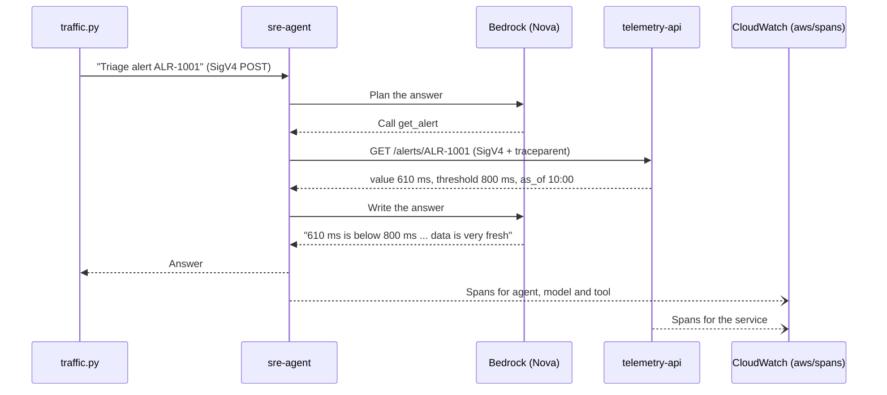
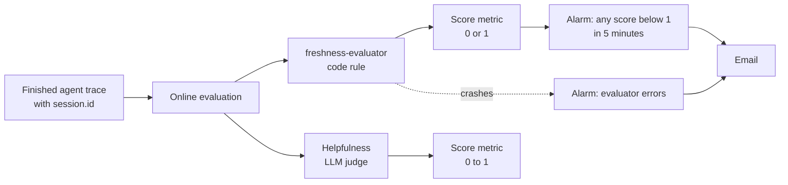

# Architecture, in plain words

This page explains how the build fits together without assuming you know CloudWatch Omni, OpenTelemetry or AgentCore. The README has the commands; this page has the "why".

## The cast

| Part | Plain description | Real-world equivalent |
|---|---|---|
| `sre-agent` | An AI assistant that triages an alert. It reads the alert, checks the latest metric, and tells you what is wrong and how fresh the data is. | An on-call copilot in Slack |
| `telemetry-api` | A small service that returns alerts, metrics and runbooks. It has a switch, `CACHE_MODE`: `fresh` returns current data, `stale` returns a 95-minute-old snapshot. | Your monitoring or data API |
| Amazon Bedrock (Nova 2 Lite) | The language model the agent thinks with. | Any hosted LLM |
| OpenTelemetry (ADOT layer) | A recorder attached to both Lambdas. It writes down every step (model call, tool call, HTTP call) as spans and sends them to CloudWatch. | APM agent |
| CloudWatch Omni | The place where you look at everything: service map, traces, agent traces, evaluation scores, and an AI assistant that investigates. | Your observability platform |
| `freshness-evaluator` | A short piece of code that reads one agent trace and answers one question: did the agent present old data as current? | A unit test that runs on production traffic |
| Online evaluation | The scheduler that feeds every finished agent trace to the evaluators and writes the scores as metrics. | A quality pipeline |
| Two alarms + SNS email | One alarm when an answer fails the freshness rule. One alarm when the evaluator itself fails. | Paging |

## What happens on one request

1. A test script sends an alert ID to the agent over an IAM-protected URL.
2. The agent asks the model what to do. The model decides to call the `get_alert` tool.
3. The tool makes a signed HTTP call to `telemetry-api`. The OpenTelemetry layer adds a `traceparent` header, so the service's spans join the agent's trace.
4. The service answers with a value and an `as_of` time. In stale mode that time is 95 minutes old, and the response comes back faster, because the slow query is skipped.
5. The model writes the final answer. With the original prompt (v1) it calls the old data "very fresh".
6. Both Lambdas send spans to CloudWatch. In Omni, the whole conversation is one trace.

Nothing in this path returns an error. That is the point of the build.

## How the answer gets checked

1. When a trace is complete, online evaluation groups it by `session.id` and sends it to two evaluators.
2. The freshness evaluator finds the tool result inside the trace, reads `as_of`, and compares it with the time the agent received the result.
   - Data younger than 15 minutes: `FRESH`, score 1.
   - Older, and the answer says so: `STALE_FLAGGED`, score 1.
   - Older, and the answer presents it as current: `STALE_UNFLAGGED`, score 0.
3. The built-in Helpfulness judge scores the same trace. It is there for contrast: it rated most stale answers "Very Helpful".
4. The scores become CloudWatch metrics. The alarm uses the minimum over 5 minutes, so one wrong answer is enough to fire.
5. If the evaluator crashes, it produces no score, and the first alarm stays quiet. The second alarm watches the evaluator's own errors.

## How the incident is found and fixed

| Step | What we did | What it showed |
|---|---|---|
| Bad deploy | Set `cache_mode=stale` in Terraform and applied | Map green, errors 0, latency down about 120 ms |
| Detect | Online evaluation + alarm | Freshness 0 on every stale answer; alarm email |
| Investigate | Asked the Omni agent about the symptom only | Found the stale payload and missing freshness telemetry; could not see the deploy (no CloudTrail tool) |
| Confirm | CloudTrail Event history | Exact time of `UpdateFunctionConfiguration` for the deploy and the rollback |
| Operational fix | Set `cache_mode=fresh` and applied | Freshness back to 1; alarm OK |
| Quality fix | v2 prompt with the current time and a freshness rule | v1 0 of 6 stale cases pass; v2 7 of 7 pass |

## Design choices and why

| Choice | Why |
|---|---|
| Both workloads on Lambda | Idle cost close to zero; the observability story does not depend on the compute platform |
| A code evaluator, not only an LLM judge | The rule fits in one sentence, so code decides it the same way every time. The LLM judge got it wrong |
| `as_of` in every tool response | The only signal that makes freshness measurable. Without it, no tool can tell stale from fresh |
| Prompt version chosen per request | v1 and v2 run on the same deployment and the same data at the same time, so the score difference comes only from the prompt |
| Account-specific values in a gitignored `terraform.tfvars` | The public repo carries no account IDs or role names |
| Required alert email checked by Terraform validation | A missing variable once made Terraform delete the alerting resources. Now the plan fails instead |

## What this build does not cover

- AWS DevOps Agent investigations (planned as a separate build).
- A model-as-judge version of the freshness rule.
- Multi-account and multi-Region setups; the pattern is the same with a central monitoring account.
